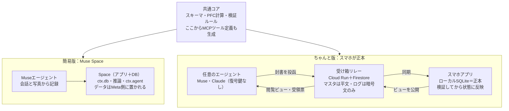

# ごまめし 二段構え化 計画書

2026-11-28 時点。原本: https://claude.ai/artifact/6XWeSMSWvvx5VXD731ANQT（このファイルはその書き出し）

## 目的とゴール

ごまめしを、Museに渡せばすぐ立つ「簡易版」と、個人データをスマホだけに置く「ちゃんと版」の二段構えで配布できるようにする。どちらも同じスキル・同じ操作名で使える。

- **簡易版**：今のSpace版を壊さずに維持する。DEPLOY.mdの手順で、今まで通りMuseが立てられる
- **ちゃんと版**：食事ログや目標値などの個人データは、スマホのローカルDBだけを正本にする。クラウドのエージェントには復号鍵を渡さない
- **共通**：MCPに対応したエージェントなら、Muse・Claudeのどちらからでも同じ操作で記録できる
- **移行**：簡易版のデータをイベント列として書き出し、ちゃんと版に取り込めるようにする

DBaaSとして運営はしない。配るのはテンプレートと手順だけで、動かすのは各利用者の環境とする。

## 現状

中核の設計はすでに二段構えに向いている。スキルで「栄養値は発明せず、数値はすべてマスタ食品×グラムからアプリ側で計算する」と決めているので、計算と検証はもう決まったコードの側にある。課題は、そのコードがMuseのホストSDK（`@hatch/space-sdk`）に密着していること。

規模：`server/src/actions.ts` に5,736行、48個のアクション。DBはDrizzle＋SQLite（`sqliteTable`）で、マイグレーションは17本。

| ホスト依存 | 使っているところ | ちゃんと版での扱い |
| --- | --- | --- |
| `ctx.db`（約52箇所） | 全データの読み書き | スマホのローカルSQLiteに差し替える |
| 推論API（`InferenceCompleteOptions`） | 成分表示の写真読み取り、食事入力アシスト、食品リサーチなど（対象アクションはP0で確定） | アプリから外してエージェント側でやる |
| `ctx.agent`（2箇所） | 深掘りリサーチ、URLからのレシピ取り込み（バックグラウンド） | エージェントに任せて、結果は `complete*` 系の書き込みで受け取る |
| `fetchPageText`（特権機能） | 食品リサーチの第2段階（メーカーページの本文取得） | エージェント自身のWeb取得に任せる |
| `ctx.invalidateQueries`（約36箇所） | 画面の更新 | ローカルDBの変更通知に置き換える |

依存先のSDKは `file:/opt/hatch/...` のローカルパスで参照されていて、Museの外ではビルドもできない。そのため、共通コアはこのSDKを一切importしない形で切り出す。

## 設計方針

データと操作を「誰が見てよいか」で分ける。そうすれば、どこに鍵が要るかがそのまま決まる。

**データは2種類**

| 種類 | 中身 | 置き場所 |
| --- | --- | --- |
| 公開マスタ | 成分表（約2,500件、`foodTableData.ts`） | 登録した市販品、レシピも含む。元はすべて公開情報なので、クラウドに平文で置き、エージェントが普通のMCPで検索・登録する |
| 個人データ | 食事ログ、目標値とその履歴。摂取グループはデータモデルから外し、各エージェントのメモリと「よく使う組み合わせ」ビューに任せる | ちゃんと版ではスマホだけが正本 |

**操作は3種類**

- **書き込み**（`logMeal`、`logAssistParts`、`upsertFood`、`saveRecipe` など）：イベントとして投函する。記録の削除も「取り消しイベント」にする
- **読み取り**（`getDailySummary`、`listMealLogs` など）：スマホが公開する閲覧ビューだけを返す
- **AI処理**（写真読み取り、食品リサーチ）：アプリから外してエージェントにやらせる。アプリは構造化された結果を受け取って検証するだけにする

**共通インターフェース**

アクションのzodスキーマを正本にして、Space版のアクションとMCPのツール定義を両方そこから作る。書き込みアクションの入力が、そのままイベントの形になる。スキル（`SKILL.md`）はどちらの版でも書き換えずに使えるようにする。

**力技を構造で防ぐ**

ちゃんと版では、エージェントはDBに直接触れない。記録の訂正もイベントとして投函し、スマホ側の検証を通ったものだけが反映される。

## 型の設計

LLMは不安定な書き手として扱う。エージェントから届くものはすべてzodの型で受け、ログに入る数値はすべてコアがマスタから計算する。下書きは `packages/core/src/types` にあり、テスト12件が通っている。

| ファイル | 中身 | 要点 |
| --- | --- | --- |
| `common.ts` | id、日付、栄養値、量 | idは文字列（`mext:<食品番号>`、`food_<ULID>`）。微量栄養素の不明は必ずnullで0にしない |
| `master.ts` | 食品、レシピ | 不変のリビジョン（rev）。出典は引用で、「ai」という出典は置かない |
| `events.ts` | 個人データを変える唯一の手段 | 投函用（rev省略可）と保存用（rev必須）の2層。訂正は取り消しイベント＋再登録 |
| `receipt.ts` | 投函への即時の返事 | 受理なら確定した食品名と数値の復唱、却下なら型付きのエラーと候補 |
| `views.ts` | スマホが公開する読み取り用データ | 日次、90日分、よく使うもの、投函の状態。全部に鮮度の情報が付く |

マスタが公開情報なので、リレーは投函を受けたその場で食品を解決し、スマホと同じ計算をできる。そのため「昼食に 鶏むね肉（皮なし）150g、計 xxx kcal を記録します」という復唱を、スマホを待たずに返せる。エージェントはこれを利用者に見せるので、聞き間違いは人の目で止まる。

過去の記録は、食品のrevを固定しているので、あとでマスタを直しても変わらない。今のアプリが `meal_logs` に栄養値をスナップショットしているのと同じ考え方。

**検索の精度を落とさない**

今の `assistMealInput` の賢さは、検索ではなくAIの2つの役割にある。AIが検索語を表記ゆれごと最大6個に広げ、サーバーが素朴な照合で最大16件を集め、AIがそこから基準食品と換算係数を選ぶ。API経由にしても、この2つをエージェントが担えれば精度は落ちない。

- `search_foods` はキーワードを配列（最大6個）で受け、今と同じ照合（`coreMatchKey` と `topFoodMatches`）で最大16件を返す。照合ロジックは書き換えずにそのままコアへ移す
- 候補には、基準（100gあたり・1食あたり）、使える単位、調理状態、利用回数を付ける
- 今のプロンプトにある選び方のルール（栄養値を推測しない、皮や骨は係数で引く、別候補を最大3つ、単一の食品で表せなければ分解）をスキルに移す
- 入力例と正解の食品の評価セットを作り、「16件に正解が入る率」と「最終的に正解を選ぶ率」を、今のSpace版とエージェント経由で比べる

## 目標アーキテクチャ

共通コアは一つだけで、器を差し替える。簡易版では今のままMuseがデータに直接触れる。ちゃんと版では、エージェントは封書を投函して閲覧ビューを読むことしかできない。簡易版からちゃんと版へは、イベント列の書き出しで移れる。

エージェントがつなぐのはスマホではなく、受け箱リレーのMCPエンドポイントです。接続はいつでもできますが、即座に整合した答えまでは保証しません。

| 操作 | 届き方 | スマホがオフラインのとき |
| --- | --- | --- |
| 書き込み（食事を記録など） | 封書として受け箱に入り、スマホが次に起きたときに検証して反映 | 受け付けはすぐ。反映は後から |
| よく使う読み取り（今日のサマリなど） | スマホが前もって公開した閲覧ビューをリレーが返す | 最後に同期した時点の値を、更新時刻つきで返す |
| 込み入った読み取り（先月の平均たんぱく質など） | リレーがプッシュでスマホを起こし、スマホが計算して返す | タイムアウトして「今は答えられない」と返す |

エージェントごとに別のトークンを発行し、権限の範囲（書き込みのみ、ビューも読める、など）を分ける。トークンは個別に無効にでき、どのエージェントが何を投函したかは封書ごとに記録する。

スマホアプリはExpo（React Native）でAndroid向けから作る。共通コアのTypeScriptと今のReact UIを流用できるからで、足りない部分だけネイティブモジュールで補う。Doze中でも起こせるようFCMは高優先度で送り、閲覧ビューの更新は定期実行（WorkManager）に任せる。

普段のフロントは安価なMuseを主に想定する。「どのエージェントからでも」は、同時に複数を使っても揃うことではなく、好きなものを選べていつでも乗り換えられることを指す。揃えるのはメモリではなく、データと操作の口。

マスタを平文でクラウドに置くので、スマホを起こして答えさせる読み取り（表の3行目）は当面作らない。通知を出さない高優先度FCMは優先度を下げられうるためで、代わりに閲覧ビューを厚くする。

## 作業計画

簡易版を常に動く状態に保ったまま、内側から順に切り出していく。P1のあと、P2とP3は並行して進められる。ちゃんと版はP3→P4→P5の順に積み上げる。

1. **P0 棚卸し**：48個のアクションを「書き込み・読み取り・AI処理・内部用」に分類した一覧を作る。推論APIと `ctx.agent` を使う箇所を確定させる
   - 結果：`docs/actions-inventory.md`（書き込み16・読み取り17・AI処理7・内部用8。ホスト依存に `ctx.tool.web_search` が追加）
   - 完了条件：全アクションに分類が付いている
2. **P1 共通コアの切り出し**：スキーマ、PFC計算、検証ルールをSDKに依存しない `core/` に移す。データの読み書きは小さなアダプタ越しにして、Space版はその上で動かす
   - 完了条件：DEPLOY.mdの手順で新しいSpaceが今まで通り立つ。`core/` のテストがMuseの外で通る
3. **P2 AI処理の外出し**：写真読み取りと食品リサーチをスキル（エージェント側）の手順に移す。アプリ側には、読み取り結果やリサーチ結果を受け取って検証する書き込みだけを残す。Space版は当面、今のホスト推論も残して互換を保つ
   - 完了条件：推論APIなしでも、写真からの記録がエージェント経由で通る
4. **P3 イベントとMCPの定義**：書き込みアクションの入力をイベントの形として固定し、MCPのツール定義をそこから生成する。簡易版にイベント列の書き出しを足す
   - 完了条件：書き出したイベント列を空のDBに流すと、日次サマリが元と一致する
5. **P4 受け箱**：Cloud RunのMCPサーバー、Firestore（エージェントは追記のみ）、スマホの公開鍵での封締、FCMでの通知を作る
   - 完了条件：エージェントの資格情報では、受け箱の読み取り・更新・削除がすべて拒否される
6. **P5 スマホアプリ**：ExpoでAndroid向けから作る。ローカルSQLite（マスタ同梱）、イベントの取り込みと検証、閲覧ビューの公開、既存のReact UIの移植を行う
   - 完了条件：Claudeから記録した食事が、スマホの日次サマリに反映される
7. **P6 配布**：DEPLOY.mdを「どちらにしますか？」で始まる二段構えにし、移行手順を足す。READMEに簡易版の割り切り（データはMeta側に置かれる、AIがデータを直接触れる）を明記する
   - 完了条件：初めてのエージェントがDEPLOY.mdだけを読んで、どちらの版も立てられる

## リスクと未決事項

いちばん先に決める必要があるのは、スマホアプリをどういう形で作るか。これでP5の作り方が変わる。

- [ ] スマホアプリの形：Expo（React Native）で、Android向けから作ることに決定。iOS対応はその後に検討する
- [ ] 食品の特定方法：マスタを公開にしたので解消。エージェントがマスタを直接引いてidを渡し、存在しないidはリレーが候補付きで却下する
- [ ] 検索の精度：エージェント経由でも、今のSpace版と同等に正解の食品を選べるかを評価セットで確かめる。今のアプリ内の推論と、エージェントとしてのMuseが同じモデルかどうかも未確認
- [ ] 食品を特定できなかったときの扱いを決める：保留にして、次に開いたとき利用者に確認する形が候補
- [ ] 利用回数（`use_count` / `last_used_at`）の置き場所：公開マスタから外し、イベントから導出して「よく使うもの」ビューで公開することに決定。検索の絞り込みの一次キーにはしない（詳細と精度確認の宿題は `docs/actions-inventory.md`）

* 閲覧ビューの鮮度：エージェントが見るのは、スマホが最後に同期した時点のサマリ。「いま何kcal？」には古い値を返すことがあるので、ビューに更新時刻を必ず付ける
* MCPの入口では、エージェントから届いた平文をリレーが一瞬だけ見る。封締したら平文は保存もログ出力もしないことを、コードとテストで担保する
* Firestoreのサーバー用ライブラリはセキュリティルールを通らない。Cloud RunのサービスアカウントのIAMで、権限を書き込みだけに絞る
* 複数デバイス間の同期は当面スコープ外。必要になったら、その部分だけEvoluなどに任せることを検討する
